# 🏠 HOMEZY — Home Services Marketplace

> منصة تجمع كل خدمات البيت في مكان واحد: مقدمو خدمة موثوقون، تقييمات حقيقية، وحجز بخطوات بسيطة.

HOMEZY connects people with trusted home-service providers — plumbers, electricians, cleaners,
AC technicians, cooks, makeup artists and personal trainers — and is based on **real customer ratings**.
It also gives **new graduates and job seekers** a safe place to earn income and build experience
through entry-level tasks (coding, file formatting, project calculations).

This repository has the full **Software Engineering course project** (requirements, UML models, test plan)
and a **working front-end prototype** built from that design.

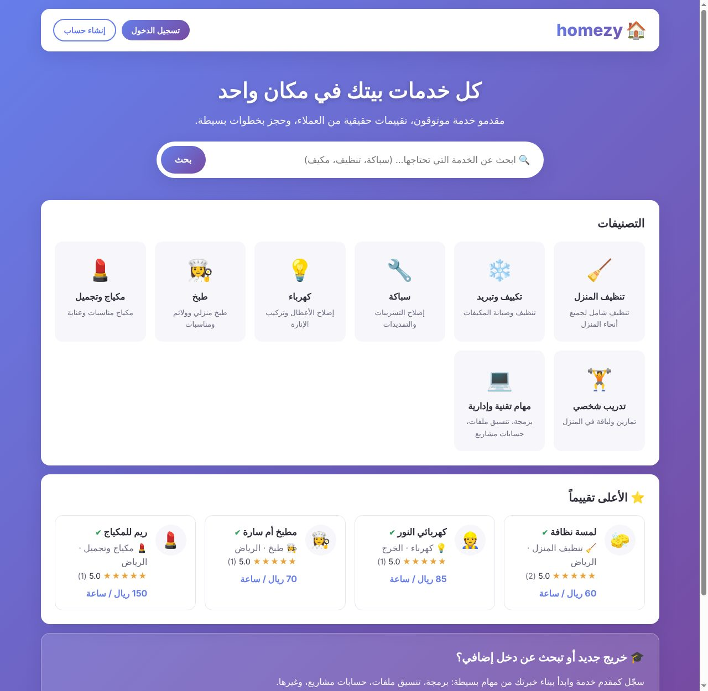

## 🚀 Try the Prototype

Open [`prototype/index.html`](prototype/index.html) in a browser — no installation needed.

Demo accounts (password: `123456`):

| Role | Email |
|---|---|
| Customer | `customer@homezy.demo` |
| Service provider | `provider@homezy.demo` |

Discount codes to try: `HOMEZY10`, `WELCOME20`

> The prototype runs fully in the browser and saves data in `localStorage` (there is no server and no real payment).
> Use **"إعادة البيانات التجريبية"** in the footer to reset the demo data.

## ✨ Features → Requirements

Every functional requirement from the specification is implemented in the prototype:

| ID | Requirement | Priority | In the prototype |
|---|---|---|---|
| FR1 | Register and create an account | High | Customer or provider sign-up, login, logout |
| FR2 | Browse services by category | High | 8 categories, search, sort by rating or price |
| FR3 | Book a service with scheduling | High | Date, time, address and notes |
| FR4 | Secure electronic payment | High | Card (simulated) or pay on completion |
| FR5 | Rate and review a provider after completion | High | Star rating + comment, updates the provider's average |
| FR6 | Providers accept / reject requests | Intermediate | Provider dashboard → Booking requests |
| FR7 | Providers manage their service listings | Intermediate | Add/remove services, edit profile and hourly rate |
| FR8 | Booking confirmation notification | Intermediate | Notification center with unread badge |
| FR9 | Discount code at payment | Low | Live price recalculation |
| FR10 | Recommendations based on history | Low | "Suggested for you" on the home page |

Also: 🎓 **New graduate** badge for providers building experience, ✔ verified providers, and a fully responsive RTL Arabic UI.

## 📸 Screenshots

| Provider profile | Booking with discount |
|---|---|
| 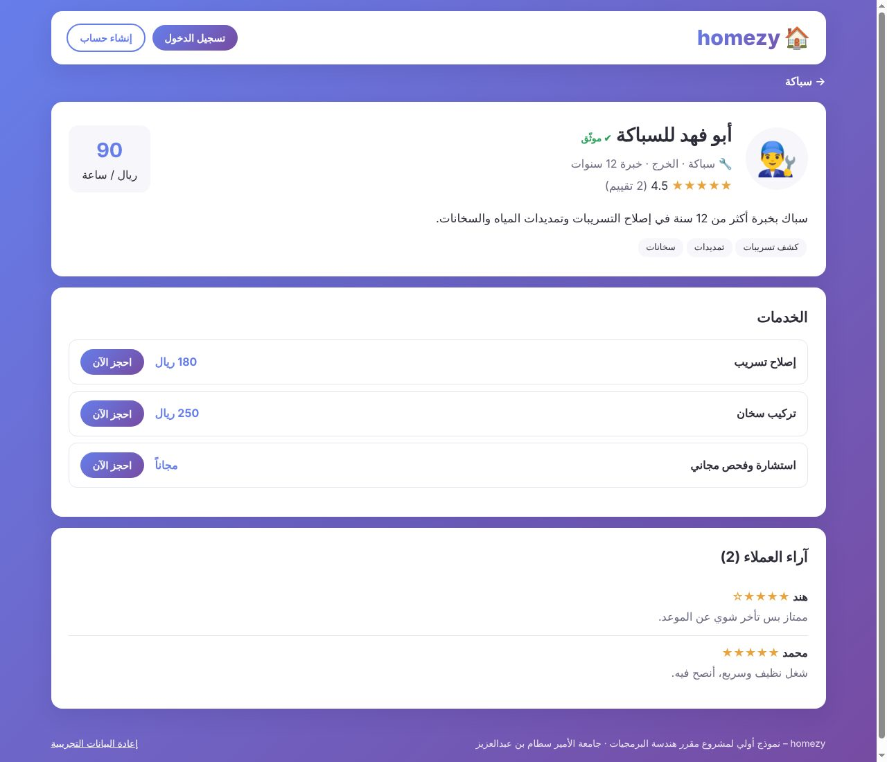 | 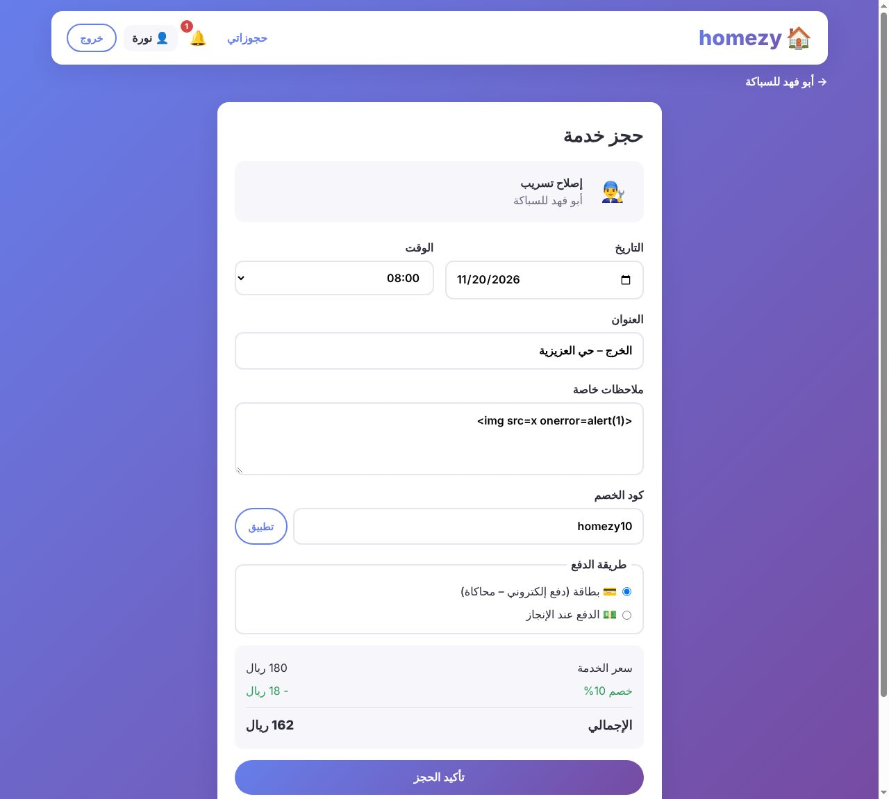 |

| Provider dashboard | My bookings + rating |
|---|---|
| 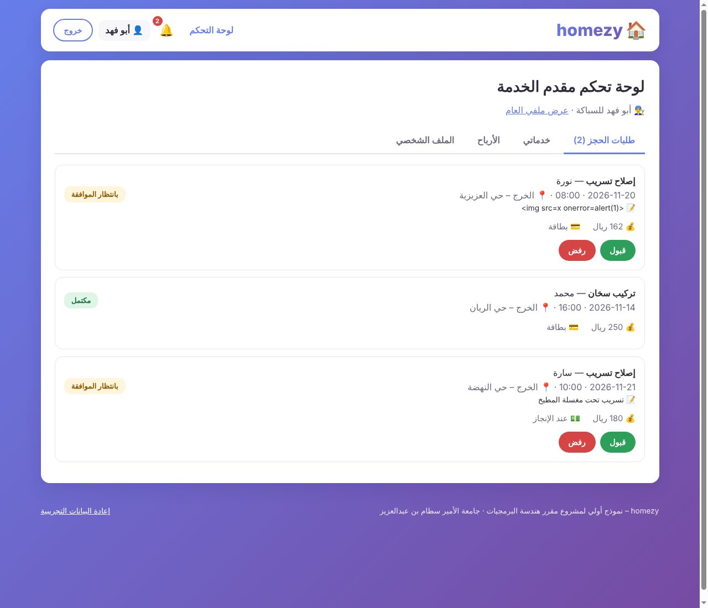 | 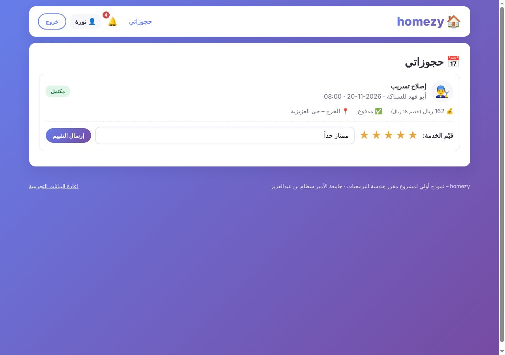 |

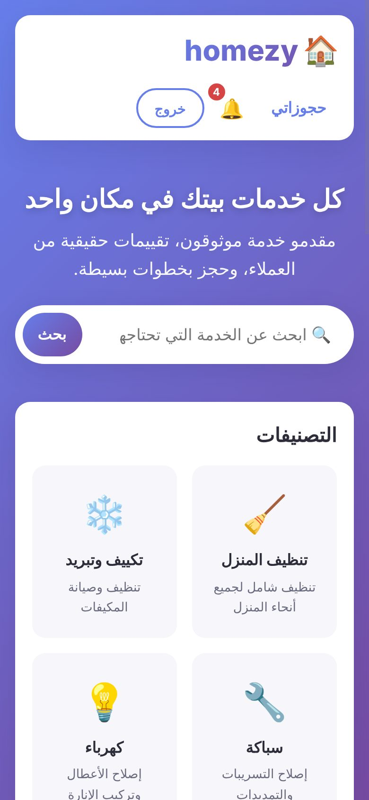

## 📐 Software Engineering Documentation

The full report is in [`docs/HOMEZY-project-report.pdf`](docs/HOMEZY-project-report.pdf). Highlights:

**Process model — Agile (Scrum):** requirements for a community marketplace change with user feedback,
so the project uses short sprints, an early MVP, and a review session at the end of each sprint.

### Class diagram
The prototype's data layer ([`prototype/js/store.js`](prototype/js/store.js)) follows this design —
`register()`, `login()`, `bookService()`, `calculateCost()`, `updateStatus()`, `respondToRequest()`, `submitReview()`.

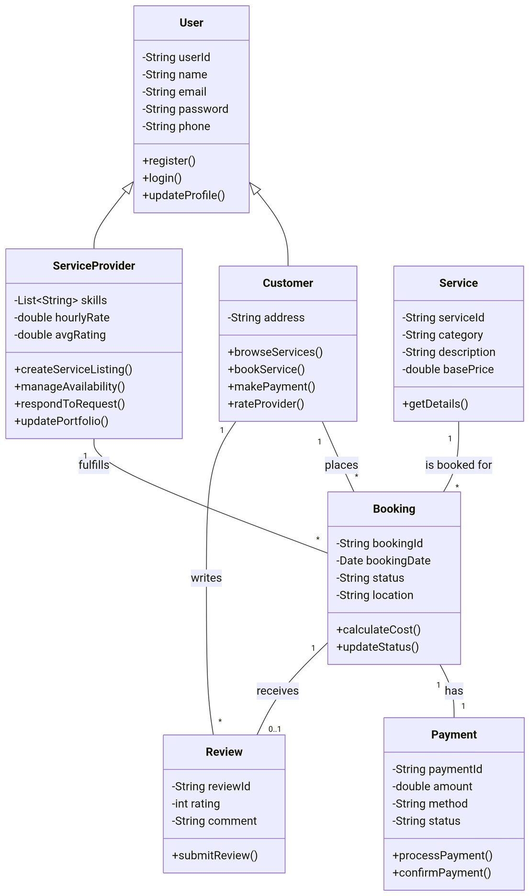

<details>
<summary><b>Use case diagram</b></summary>

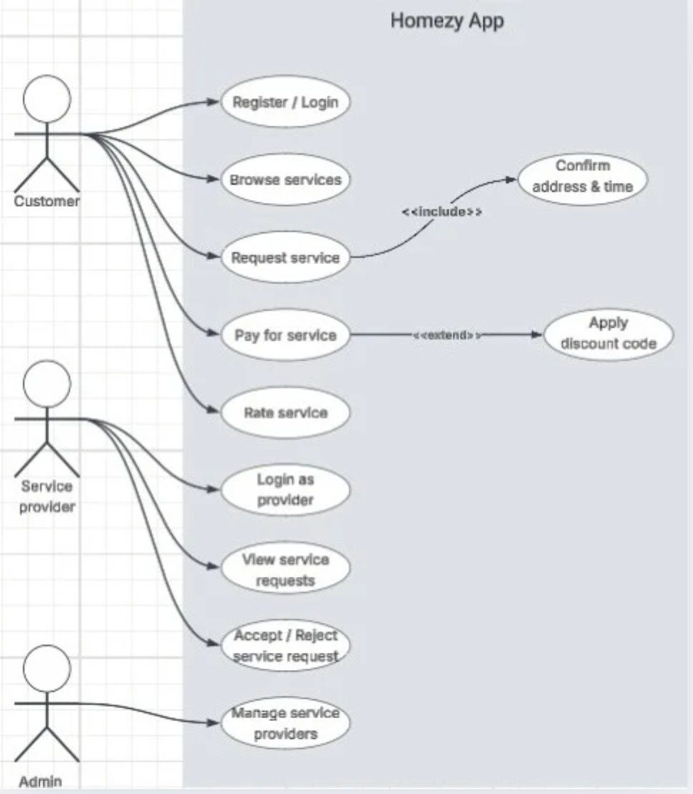
</details>

<details>
<summary><b>Sequence diagrams</b> — booking a service, provider accepting a request</summary>

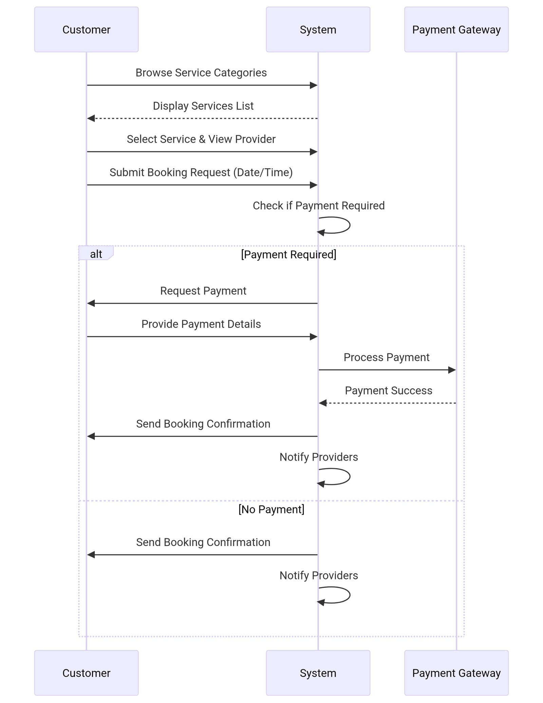
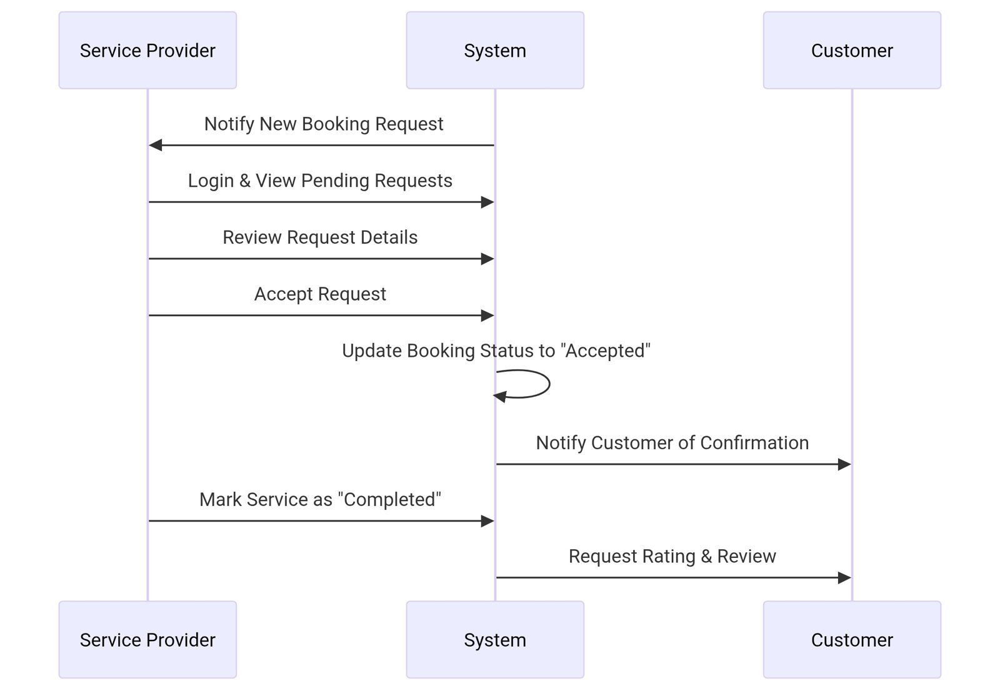
</details>

<details>
<summary><b>Activity diagram</b></summary>

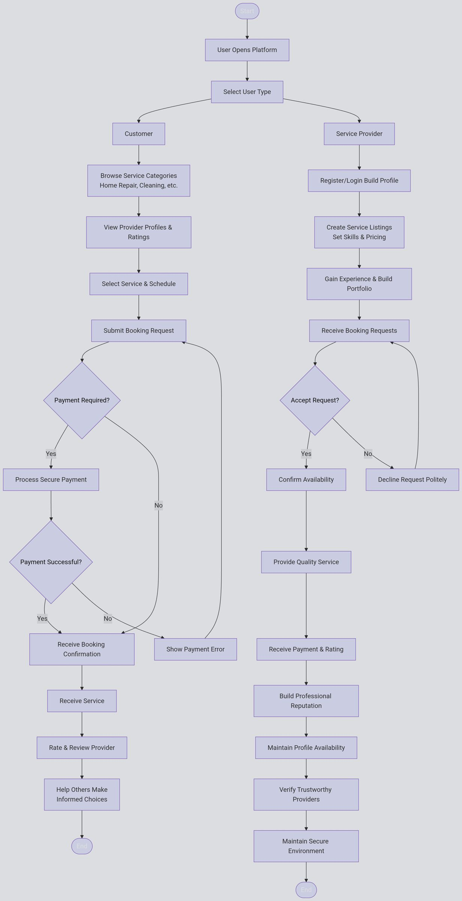
</details>

<details>
<summary><b>Requirements</b> — functional and non-functional</summary>

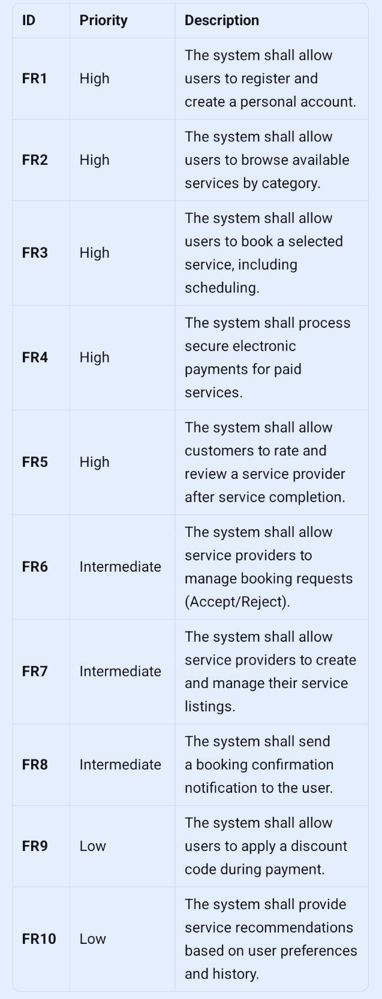
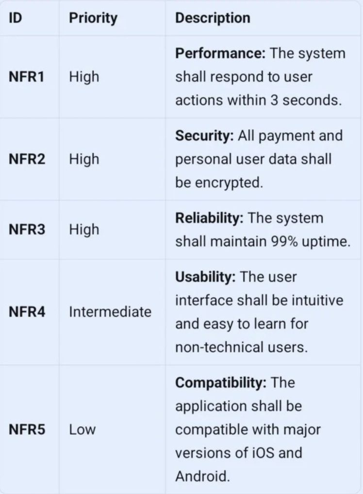
</details>

<details>
<summary><b>User acceptance test cases</b></summary>

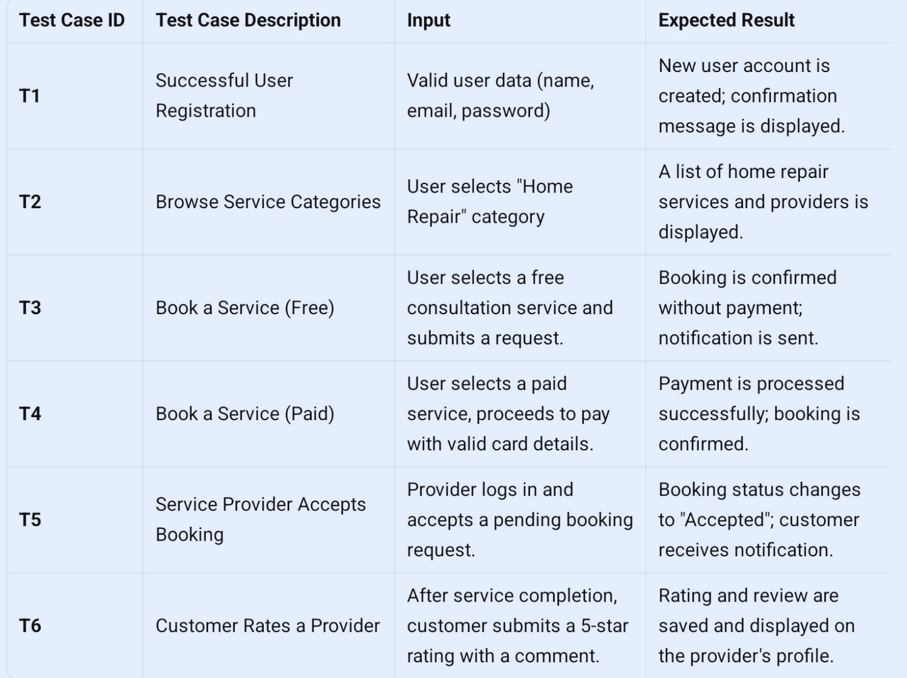

All six test cases (T1–T6) pass in the prototype: registration, browsing a category,
free booking, paid booking, provider accepting a booking, and customer rating a provider.
</details>

## 🧰 Tech Stack

- HTML5, CSS3 (RTL layout, responsive)
- Vanilla JavaScript — single-page app with hash routing, no frameworks
- `localStorage` as a mock database; passwords stored as SHA-256 hashes (Web Crypto API)
- All user input is HTML-escaped before rendering (XSS-safe)

```
prototype/
├── index.html
├── css/styles.css
└── js/
    ├── data.js    # Categories, providers, reviews, demo accounts
    ├── store.js   # Data layer (users, bookings, payments, reviews, notifications)
    └── app.js     # Screens, router and event handling
```

## 🛣 Next Steps

- Backend API and database (e.g. Node.js or Laravel + MySQL)
- Real payment gateway (e.g. Moyasar or Tap) and SMS notifications
- Map-based provider search and identity verification for providers

## 👥 Team

Software Engineering course project — Prince Sattam bin Abdulaziz University, College of Computer Engineering and Sciences.

- **Nora Abdulaziz** ([@nora2164](https://github.com/nora2164))
- Leen Abdulaziz
- Shatha Al-Zahrani
- Renad Amer
